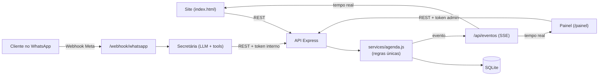

# ✂ Fio Fino Barbearia — Ecossistema de Agendamento

Site mobile-first + Secretária Virtual no WhatsApp (IA) + Painel administrativo, sobre **uma única API** e **um único banco**. Sem login, sem gateway de pagamento: o **WhatsApp do cliente é a identidade** dele em todo o sistema.



**Sincronização bidirecional:** todo agendamento (site, IA ou painel) passa por `services/agenda.js`, que grava no banco numa transação e publica um evento SSE. O site recarrega na hora a grade daquele barbeiro/dia, e a IA lê os agendamentos do cliente **ao vivo** a cada mensagem.

---

## 🚀 Como rodar

Requer **Node.js 22.13+** (usa o SQLite embutido `node:sqlite`, sem compilação nativa).

```bash
npm install
cp .env.example .env        # no Windows: copy .env.example .env
npm run seed                # serviços, 2 barbeiros, expediente (idempotente)
npm run dev                 # http://localhost:3000
```

| URL | O quê |
|---|---|
| `http://localhost:3000` | Site |
| `http://localhost:3000/painel` | Painel admin (token = `ADMIN_TOKEN`) |

## ⚙️ Variáveis de ambiente (`.env`)

| Variável | Para quê |
|---|---|
| `PORT`, `API_BASE_URL` | Porta e URL onde a própria API responde (a IA chama a API por ela) |
| `DB_PATH` | Arquivo SQLite (padrão `./data/fiofino.db`) |
| `TZ_BARBEARIA` | `America/Fortaleza` (Campina Grande, UTC-3) |
| `SLOT_MINUTOS` | Intervalo entre horários exibidos (30) |
| `JANELA_DIAS` | Até quantos dias à frente aceitar agendamento (30) |
| `ANTECEDENCIA_MIN_MINUTOS` | Antecedência mínima (30) |
| `MAX_AGENDAMENTOS_FUTUROS_POR_CLIENTE` | Anti-abuso (3) |
| `ADMIN_TOKEN` | Acesso ao painel e `/admin/*` — **troque!** |
| `INTERNAL_API_TOKEN` | Acesso da IA a `/api/interno/*` — **troque!** |
| `WA_VERIFY_TOKEN`, `WA_APP_SECRET`, `WA_ACCESS_TOKEN`, `WA_PHONE_NUMBER_ID` | WhatsApp Cloud API (Meta) |
| `LLM_BASE_URL`, `LLM_API_KEY`, `LLM_MODEL` | Provedor de IA (ver abaixo) |

## 🎨 Personalização

- **Telefones, Instagram, endereço, número da IA:** `public/js/config.js` (site) e `src/config.js` (IA).
- **Serviços, preços, barbeiros, expediente:** `src/db/seed.js` (rodar antes do primeiro uso) ou direto no banco.
- **Avaliações:** placeholders em `public/index.html`, seção `#avaliacoes`.
- **Fotos dos barbeiros:** coluna `barbeiros.foto_url` (sem foto, aparece a inicial).

---

## 📡 API REST

### Pública (site)
| Método | Rota | Descrição |
|---|---|---|
| GET | `/api/servicos` | Serviços com `preco_centavos` e `duracao_min` |
| GET | `/api/barbeiros` | Profissionais e `dias_atendimento` |
| GET | `/api/horarios-disponiveis?barbeiro_id&servico_id&data` | Grade do dia com `disponivel: true/false` |
| POST | `/api/agendamentos` | `{ nome, whatsapp, barbeiro_id, servico_id, inicio: "2026-11-05T08:00" }` |
| GET | `/api/eventos` | Stream SSE de mudanças na agenda (sem dados pessoais) |

Erros seguem `{ erro: { codigo, mensagem, detalhes } }` — ex.: `409 HORARIO_INDISPONIVEL` traz `detalhes.alternativas`.

### Interna (IA) — header `X-Internal-Token`
| Método | Rota |
|---|---|
| GET | `/api/interno/clientes/:whatsapp` — cliente + próximos agendamentos |
| POST | `/api/interno/agendamentos` |
| PATCH | `/api/interno/agendamentos/:id/remarcar` — `{ whatsapp, inicio, barbeiro_id?, servico_id? }` |
| PATCH | `/api/interno/agendamentos/:id/cancelar` — `{ whatsapp, motivo? }` |

### Admin — header `Authorization: Bearer <ADMIN_TOKEN>`
| Método | Rota |
|---|---|
| GET | `/admin/relatorio-diario?data=AAAA-MM-DD` → `clientes_atendidos`, `faturamento_total_centavos` + detalhes |
| GET | `/admin/relatorio-diario?data=...&formato=csv` → planilha (`;` + UTF-8 BOM, abre direto no Excel) |
| GET | `/admin/agendamentos?data=...` |
| PATCH | `/admin/agendamentos/:id/status` — `{ status: "concluido", forma_pagamento: "pix" }` |

> **Regra do relatório:** só atendimentos marcados como **Concluído** no painel entram em "clientes atendidos" e "faturamento". O relatório também mostra a receita *prevista* (confirmados) e faltas/cancelamentos.

---

## 🤖 Secretária Virtual (WhatsApp + IA)

`src/ai/secretaria.js` usa **LLM com tool calling**. A cada mensagem:

1. Identifica o cliente pelo número do remetente (normalizado — trata o `wa_id` da Meta que vem sem o 9º dígito).
2. Injeta no prompt: data/hora atual, calendário dos próximos 14 dias (para entender "terça", "amanhã"), cadastro e agendamentos **ao vivo**.
3. O LLM chama ferramentas (`consultar_horarios`, `criar_agendamento`, `remarcar_agendamento`, `cancelar_agendamento`, …) que batem na API REST.
4. O WhatsApp **nunca** é parâmetro do LLM: o servidor injeta o do remetente, então ninguém mexe em agendamento alheio.

Exemplo: *"passa minha terça pra quarta às 8h"* → `meus_agendamentos` → `consultar_horarios(quarta)` → `remarcar_agendamento` → confirmação. O site libera a terça e bloqueia a quarta no mesmo instante.

### Provedor de LLM (qualquer endpoint compatível com OpenAI)
```env
# OpenAI
LLM_BASE_URL=https://api.openai.com/v1
LLM_MODEL=gpt-4o-mini
# Google Gemini
LLM_BASE_URL=https://generativelanguage.googleapis.com/v1beta/openai
LLM_MODEL=gemini-2.0-flash
```
Sem `LLM_API_KEY`, a secretária entra em modo degradado: cumprimenta pelo nome, informa o próximo horário e indica site/telefones.

### Testar sem a Meta
```bash
curl -X POST http://localhost:3000/webhook/simular -H "Content-Type: application/json" \
  -d '{"whatsapp":"83988887777","texto":"Quero cortar amanhã de manhã","nome":"João"}'
```
(PowerShell: `Invoke-RestMethod -Method Post -Uri http://localhost:3000/webhook/simular -ContentType 'application/json' -Body '{"whatsapp":"83988887777","texto":"oi"}'`)

Disponível só com `NODE_ENV` diferente de `production`.

### Conectar ao WhatsApp de verdade
1. Crie um app em [developers.facebook.com](https://developers.facebook.com) → produto **WhatsApp** → copie `WA_PHONE_NUMBER_ID` e gere um token permanente (`WA_ACCESS_TOKEN`) via usuário de sistema.
2. Exponha o servidor em HTTPS (deploy ou `ngrok http 3000` para testes).
3. Em *Webhooks*, URL `https://SEU_DOMINIO/webhook/whatsapp`, token = `WA_VERIFY_TOKEN`, assine o campo **messages**.
4. Defina `WA_APP_SECRET` (valida a assinatura `X-Hub-Signature-256` — obrigatório em produção).

O webhook responde 200 na hora, ignora reentregas (`mensagens_processadas`) e processa mensagens do mesmo número em fila, em ordem.

---

## 🗄️ Banco de dados

`src/db/schema.sql` — dinheiro em **centavos**, horários locais `AAAA-MM-DDTHH:MM`.

| Tabela | Papel |
|---|---|
| `clientes` | PK = WhatsApp normalizado (`5583988887777`) |
| `barbeiros`, `expedientes`, `bloqueios` | Profissionais, turnos semanais, folgas/feriados |
| `servicos` | Catálogo e preço vigente |
| `agendamentos` | **Snapshot** de nome/valor/duração do serviço no ato do agendamento; índice único parcial impede double-booking |
| `agendamento_eventos` | Auditoria: quem criou/remarcou/cancelou e por qual canal |
| `conversas_ia`, `mensagens_processadas` | Memória da IA e idempotência do webhook |

### Preparado para o futuro módulo financeiro
- `lancamentos_financeiros` — livro-caixa único. Um **trigger** lança a receita automaticamente quando o atendimento é concluído (e estorna se for desfeito). O futuro site só precisa lançar as **despesas**.
- `categorias_financeiras`, `metas_mensais` (faturamento, atendimentos, lucro líquido — por barbearia ou por barbeiro), `barbeiros.comissao_percentual`, `agendamentos.forma_pagamento`.
- `vw_resumo_diario` — visão pronta para dashboards.

Lucro líquido do mês, por exemplo:
```sql
SELECT SUM(CASE tipo WHEN 'receita' THEN valor_centavos ELSE -valor_centavos END) / 100.0
FROM lancamentos_financeiros WHERE data_competencia LIKE '2026-11-%';
```

---

## 🏗️ Estrutura

```
public/
  index.html  painel.html
  css/style.css  css/painel.css
  js/config.js  js/app.js  js/painel.js
  assets/  (logo e identidade visual)
src/
  server.js  config.js
  db/        index.js  schema.sql  seed.js
  services/  agenda.js          ← regras de negócio (fonte única)
  routes/    publicas.js  internas.js  admin.js  webhook.js
  ai/        secretaria.js  apiClient.js  whatsapp.js
  lib/       tempo.js  telefone.js  realtime.js  http.js  erros.js
```

## 📈 Escalando

O processo único com SQLite síncrono serializa as escritas: não há corrida entre site e WhatsApp, e isso atende tranquilamente uma barbearia. Para várias instâncias: PostgreSQL (o schema é quase todo portável; use `EXCLUDE USING gist` para sobreposição) + Redis Pub/Sub ou `LISTEN/NOTIFY` no lugar do Set do SSE.

## ✅ Antes de ir para produção
- [ ] Trocar `ADMIN_TOKEN` e `INTERNAL_API_TOKEN` por valores longos e aleatórios
- [ ] `NODE_ENV=production` e `WA_APP_SECRET` definido
- [ ] Dados reais em `public/js/config.js`, `src/config.js` e `src/db/seed.js`
- [ ] HTTPS (Nginx/Caddy) — o SSE já envia `X-Accel-Buffering: no`
- [ ] Backup diário de `data/fiofino.db`
